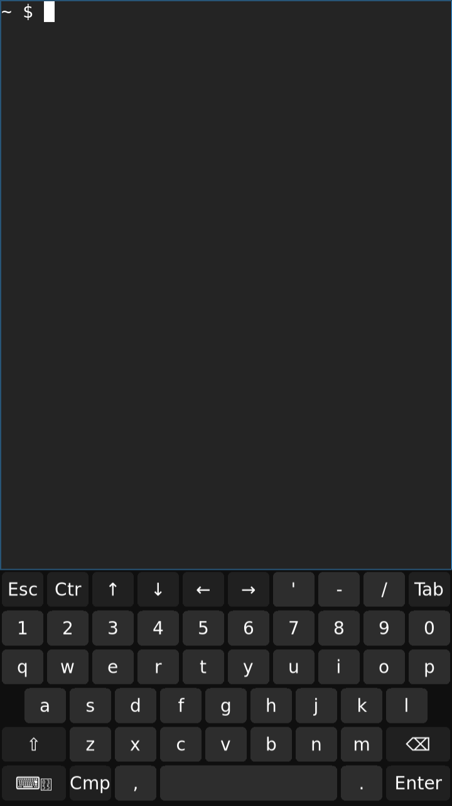

# Native Wayland console test

This controlled session tests native DRM, software rendering and touch before
starting the full Sxmo interface. It uses the normal packaged TinyDM login/seat
setup, a Sway terminal and wvkbd. It does not start an idle/suspend policy.
GPU acceleration and suspend remain separate bringup work.

The tested Nura v26.06 installation has the signed native r1 kernel and matching
persistent modules. `postmarketos-ui-sxmo-de-sway` installs successfully from its
configured repositories. The tested versions are Sxmo meta1.18.0 and
sxmo-utils1.18.1-r4. The kernel, DTB and initramfs hashes remain unchanged after
that package transaction. Reverse USB internet provides package access and NTP;
this does not qualify wireless or cellular hardware.

Copy the desktop entry to `/usr/share/wayland-sessions/`, the executable wrapper
to `/usr/local/libexec/fx0-sway-test`, and the config to
`/etc/sway/fx0-console.conf`. TinyDM recognizes session type from the desktop
entry's directory. Add the login user to `input` and `seat`, as required by the
Sxmo package recipe. Use the actual login UID and runtime directory; this image's
user is UID10000. Its packaged TinyDM service has a PAM login on tty1 and
conflicts with the existing getty.

The wrapper selects Pixman and the native display-controller DRM by-path node.
It does not assume a fixed card number or claim GPU acceleration. The first-start
drop-in holds automatic launch until `/run/fx0-ui-start-ready` exists, and disables
repeated automatic restarts during the test. Install it under
`/etc/systemd/system/tinydm.service.d/`; remove this development gate when normal
UI startup is qualified.

Before starting, validate the config as the login user with explicit
`XDG_RUNTIME_DIR`, `WLR_BACKENDS=headless` and `WLR_RENDERER=pixman`, then use:

```sh
tinydm-set-session -f -s /usr/share/wayland-sessions/fx0-console.desktop
systemctl daemon-reload
touch /run/fx0-ui-start-ready
systemctl start tinydm.service
```

For remote IPC, supply the actual Sway socket explicitly. In this test,
`swaymsg` could not discover it from a separate login despite the correct runtime
directory. The socket is under the login user's `/run/user/UID/` directory.
Run the IPC client as that user. `get_outputs`, `get_inputs`, `get_tree` and
`get_seats` provide independent session checks. Keep full logs and pointers
private. A screenshot via grim verifies software output only; physical display
confirmation is also required.

## Observed result and touch correction

The owner confirms the terminal and keyboard are physically visible. Sway reports
DSI-1 active at720×1280/60Hz, with scale1.5 and a480×853 logical workspace. Kernel
taint remains0. The inspected screenshot contains only a generic prompt and
keyboard:



The initial apparent lack of touch response is an orientation error: touching
opposite the keyboard produces keystrokes. A Y-only inversion helps, and the
owner identifies the remaining X inversion. With the temporary normalized
matrix `-1 0 1 0 -1 1`, the owner confirms keys match taps. Concurrent recordings
contain1,432 raw events and382 processed libinput touch records; RMI interrupts
increase from431 to694.

The board-level correction adds `touchscreen-inverted-x` and
`touchscreen-inverted-y` to RMI Function12. The normal driver already parses
these properties. The candidate DTB builds, passes its RMI schema check and
differs semantically only by those two booleans. Its source is
`87d953b4a0ce9594a6a438579c1d2a489faaa00b`, based on the tested476 integration.
A RAM boot loads both properties with taint0 and restarts this session with
identity compositor calibration. The owner confirms taps still match the
displayed keys, including both keyboard sides. The same correction is now in the
signed native r2 APK; an eMMC boot passes the physical text/keyboard/tap check. Do not combine the temporary matrix with the DTB
inversions: that would apply the same correction twice.

The full Sxmo session, GPU, default unattended boot, repeated/cold boot, suspend,
rotation/noise/edge accuracy and remaining hardware/recovery/storage acceptance
are still open. This test fixture is not a final UI configuration or an upstream
kernel startup fix.
