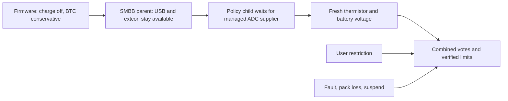

# Experimental Fx0 charging policy

The [Linux branch](https://github.com/timschmidt/fx0-linux/tree/integration/fx0-charging-policy)
connects the verified actuator and early firmware gate to a managed policy child.
The [firmware branch](https://github.com/timschmidt/fx0-lk2nd/tree/integration/fx0-policy-profile)
adds a runtime policy identifier only for the existing, unambiguous TOCAD Madai
selection and explicit software-control opt-in. No pack model or fallback is
authored in the board DTS. The identifier is boot-time selection, not direct
authentication of the pack silicon.



The parent validates the proposed handoff marker and actual inhibited/conservative
hardware state before releasing its setup vote. Invalid handoff, missing policy,
unknown profile or unavailable sensors keep charging inhibited. Child supplier
links defer/remove the policy without removing the parent USB/extcon interface.
The binding and Kconfig interfaces are experimental, not accepted upstream ABI.

The child reads raw thermistor voltage and converts the exact 83 stock table
points without clamping open/short/endpoints. It uses the stock LG V1_8 normal,
450 mA reduced-current and stop transitions, including the 4.0 V warm-battery
cutoff and recovery hysteresis. Initial/fault recovery starts stopped. The
existing 1.2 A board ceiling and runtime 4.35 V profile ceiling remain upper
bounds; a battery charge-current rating is not invented. Read errors, invalid
voltage, stale data and voltage above the configured target inhibit charging.
Every enable/limit write is verified. Policy-directed limit changes occur while
inhibited; user caps remain within the active thermal and board ceilings.

User requests cannot erase thermal/sample/pack/suspend/handoff/I/O-fault votes or
raise the effective current above the thermal/board limits. Every enable attempt
checks sample expiry, including user auto. A separate high-priority age worker
also inhibits stale operation. These scheduled checks are not a hard deadline
under a stalled CPU; hardware-watchdog protection remains to qualify before any
wider BTC window. BTC stays at the conservative enabled 0x81 setting.

Observed battery removal, uncertain presence, or any presence IRQ after the
initial sample invalidates boot-time pack identity. The built-in-only prototype
keeps that loss latched across parent reprobe until reboot. Live reidentification
and unobserved replacement before native monitoring remain unqualified.

Suspend quiesce marks work stopped, verifies inhibition, and cancels both jobs
before allowing supplier suspend. A failed actuator operation fails suspend.
Resume requires a fresh sample before releasing the suspend vote. Managed cleanup
quiesces before channels disappear. Actual system suspend is not qualified by
the host callback tests or the RAM supplier test.

Run the actual-source regressions:

```sh
python3 diagnostics/smbb-charging-policy/check-model.py /path/to/linux /path/to/vendor-linux
python3 diagnostics/smbb-charging-policy/check-control.py /path/to/linux
python3 diagnostics/smbb-charging-policy/check-firmware-profile.py /path/to/lk2nd
python3 diagnostics/vadc-battery-units/check.py /path/to/linux
```

They cover 21,496 conversion/LG transition cases, 2,604 policy worker/actuator/
fault/stale/quiesce/handoff cases (including 2,500 concurrent requests), the
existing 6,242 control cases, 41 runtime profile/FDT rollback cases and 84 voltage
ABI cases. The policy model is compared with the actual original LG functions.
Helpers/workers are extracted from the real driver; these tests do not execute
the complete kernel probe or device-link implementation. Strict driver style
checks omit DCO and the generic new-file notice; subsystem MAINTAINERS patterns
already cover the new files. No personal sign-off or upstream submission is made.

The installed r4 ADC exposes raw battery channel codes. Carry the processed-
voltage and millivolt-precision prerequisites and build the matching VADC module;
do not substitute the old module. The initially prepared candidate was caught at
this check and was never booted. The isolated `build.py`/`init` diagnostic uses
only RAM, virtual mounts, read-only available eMMC devices and a read-only USB
HTTP endpoint. It automatically returns, with a separate 180-second timer after
init begins. Preserve exact images, original boot files/prefix/GPT on two host
filesystems, and keep physical/raw logs private.

The hardware run verifies USB HTTP while the ADC is absent, then fresh automatic
policy binding after module load. It reports about 30.8 C and 4.287 V, honors user
inhibit, and keeps USB responding through managed supplier unbind. Charging is
inhibited while the policy is removed. Supplier rebind requires an explicit
`drivers_probe` before fresh policy operation returns; automatic recovery from
forced unbind is not claimed. Diagnostic taint is 12288. These observations do
not qualify charging current, absolute sensor accuracy or SOC.

The host controller hit duplicate temporary network-profile names during USB
interface rename. Both profiles were already deleted; an extra deletion stopped
the final return step. Cleanup was verified, then the same return was resumed
without repeating the hardware test. Unique names/idempotent cleanup fix that
host issue. Installed r4 returns with taint zero and normal services; no temporary
network profiles remain. No firmware or kernel package is installed permanently.

The [source/image manifest](../../manifests/smbb-native-policy.json) pins the
qualified inputs. The [sanitized evidence](../../evidence/2026-10-30-smbb-native-policy.json)
records host checks, actual USB observations and the resumed return separately.
